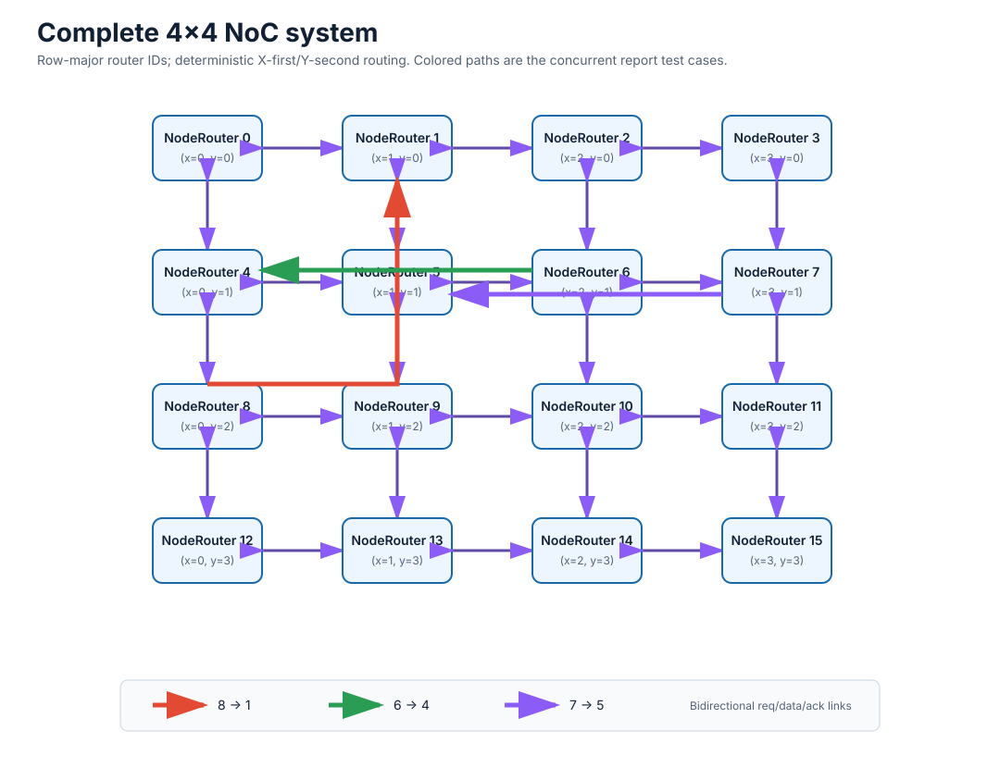
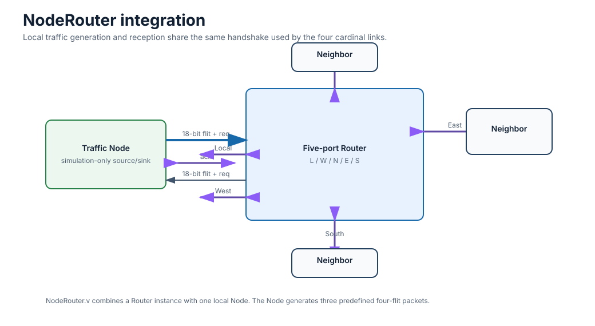
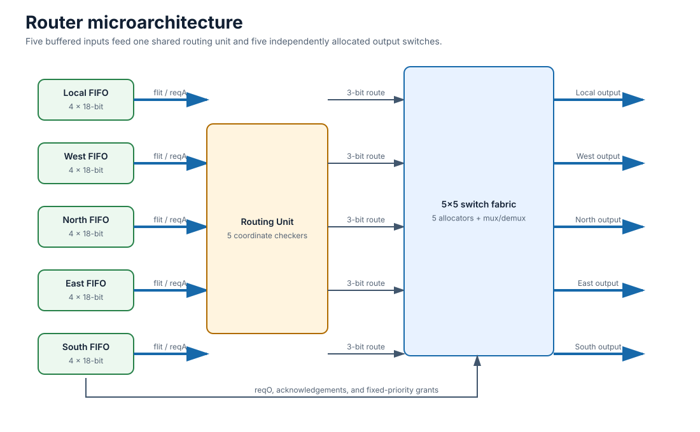
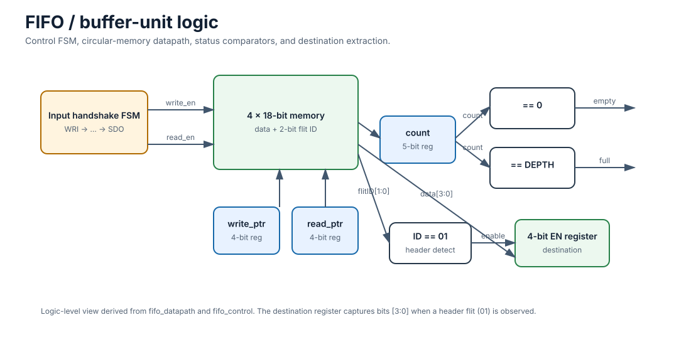
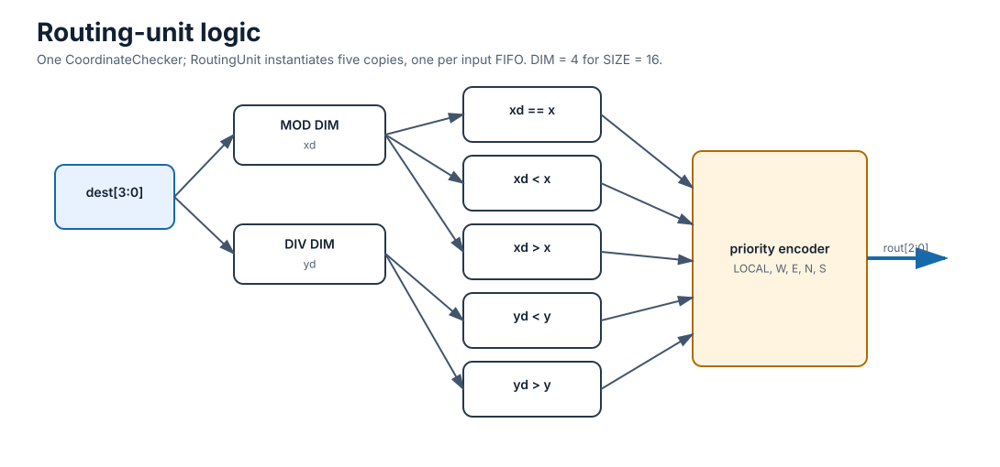
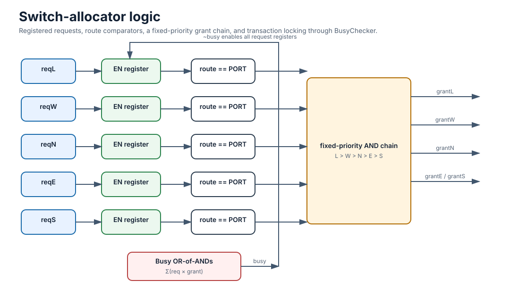

# 4×4 Mesh Network-on-Chip in Verilog

A parameterized, packet-switched Network-on-Chip (NoC) built as a 4×4 two-dimensional mesh. Each of the 16 tiles combines a five-port router with a local traffic node. The router uses input buffering, deterministic XY routing, fixed-priority output arbitration, and request/acknowledge handshakes.



## Design summary

| Property | Default configuration |
| --- | --- |
| Topology | 4×4 bidirectional mesh |
| Number of tiles | 16 |
| Router ports | Local, West, North, East, South |
| Data payload width | 16 bits |
| Flit width | 18 bits: 2-bit type plus 16-bit payload |
| Input buffers | Five FIFOs per router |
| FIFO depth | Four flits |
| Routing | Deterministic XY, X dimension before Y |
| Arbitration | Fixed priority: Local > West > North > East > South |
| Flow control | Per-link request/acknowledge handshake |
| Default top module | `NoC` |
| Main system testbench | `NoC_TB` |

## System architecture

Router IDs use row-major order. For the default configuration, router `0` is at coordinate `(0,0)`, router `3` is at `(3,0)`, and router `15` is at `(3,3)`. The top-level `NoC` module creates the mesh with nested generate loops and connects adjacent tiles through separate data, request, and acknowledge signals in both directions.

| Row | West to east |
| --- | --- |
| 0 | `0` `1` `2` `3` |
| 1 | `4` `5` `6` `7` |
| 2 | `8` `9` `10` `11` |
| 3 | `12` `13` `14` `15` |

Each tile is a `NodeRouter` wrapper. Its local port attaches a traffic-generating `Node` to a `Router`; its remaining four ports attach to neighboring routers.



The supplied system testbench starts three packets on consecutive clock edges. These packets travel from node 8 to node 1, node 6 to node 4, and node 7 to node 5. The paths overlap and exercise simultaneous arbitration.

## Router microarchitecture

Every input port owns a four-entry FIFO. After a complete packet has been accepted, the FIFO exposes its destination to the routing unit and requests an output. A single `RoutingUnit` computes a three-bit direction for each of the five input buffers. Five output `Switch` instances then arbitrate independently, select one buffered input, and return the downstream acknowledgement to the selected FIFO.



| Route code | Output |
| --- | --- |
| `3'b000` | Local |
| `3'b001` | West |
| `3'b010` | North |
| `3'b011` | East |
| `3'b100` | South |

### Input buffer and packet lifecycle

The buffer is split into `fifo_datapath` and `fifo_control`. The datapath stores payload and flit-type bits in parallel memories, maintains read and write pointers, and tracks occupancy. The controller waits for an upstream request, acknowledges packet admission, writes the incoming flits, requests a routed output, and drains the stored packet after output arbitration succeeds.



The controller follows this sequence:

`WRI → GAI → WAIT1 → WAIT2 → RDI → RP → GRO → WAO → WAIT3 → SDO`

| State group | Function |
| --- | --- |
| `WRI`, `GAI` | Wait for and acknowledge the upstream packet request |
| `WAIT1`, `WAIT2` | Provide handshake settling cycles |
| `RDI` | Write flits until a tail flit is observed |
| `RP` | Request allocation for the decoded destination |
| `GRO`, `WAO` | Request the output and wait for the downstream handshake |
| `WAIT3`, `SDO` | Read and transmit the packet until its tail leaves the FIFO |

### Flit format

The external data path is `DATA_WIDTH + 2` bits. With the default `DATA_WIDTH = 16`, every flit is 18 bits wide.

| Bits | Field | Meaning |
| --- | --- | --- |
| `[17:16]` | Flit ID | `01` header, `00` body, `10` tail |
| `[15:8]` | Header metadata | Traffic-pattern field used by the supplied node |
| `[7:4]` | Source | Four-bit source node ID in header flits |
| `[3:0]` | Destination | Four-bit destination node ID in header flits |

The destination register captures `data[3:0]` when the stored flit ID equals `2'b01`. The built-in traffic node emits fixed four-flit packets consisting of one header, two body flits, and one tail.

### XY routing

`CordinateChecker` derives destination coordinates as `xd = dest % DIM` and `yd = dest / DIM`. It compares those coordinates with the current router coordinates. Horizontal movement has priority: West or East is selected until `xd` equals the local X coordinate, after which North or South is selected. A matching X and Y coordinate selects the Local output.



This order is deterministic and prevents routing cycles for the intended rectangular mesh because packets never return to the X dimension after entering the Y dimension.

### Switch allocation and datapath

One `SwitchAllocator` is instantiated for each output port. Each allocator checks all five input requests against that output's port ID. Matching requests enter a fixed-priority AND chain. `BusyChecker` locks the current decision while an active request still owns its grant, preventing a newly arriving, higher-priority input from interrupting a packet already in flight.



The selected grant controls two primitives. A five-input one-hot multiplexer forwards `{reqO, data}` to the chosen output, while a one-hot demultiplexer returns the downstream acknowledgement only to the selected input buffer.

## Handshake behavior

The design uses two related handshakes around each input buffer. At packet admission, an upstream sender raises `reqI` and waits for `ackI`; after admission, it lowers `reqI` and presents the flits. For forwarding, the FIFO raises `reqA` to obtain a switch grant and then raises `reqO` toward the next hop. The downstream `ackO` completes the transfer. The switch maps these signals to the appropriate input without broadcasting acknowledgements to competing inputs.

Signal names are written from the buffer's point of view:

| Signal | Direction at FIFO | Purpose |
| --- | --- | --- |
| `reqI`, `ackI` | Input, output | Packet-admission request and acknowledgement |
| `reqA`, `ackA` | Output, input | Switch-allocation request and grant |
| `reqO`, `ackO` | Output, input | Downstream transfer request and acknowledgement |
| `data_in`, `data_out` | Input, output | 18-bit flit path at default width |

## Repository layout

```text
.
├── README.md
├── rtl
│   ├── FIFO.v
│   ├── NoC.v
│   ├── Node.v
│   ├── NodeRouter.v
│   ├── Router.v
│   ├── RoutingUnit.v
│   ├── SwitchAlocator.v
│   └── premitives.v
├── tb
│   ├── FIFO_TB.v
│   ├── NoC_TB.v
│   └── NodeRouterTB.v
└── docs
    └── diagrams
        ├── fifo-gate-level.svg
        ├── noc-system.svg
        ├── node-router.svg
        ├── router-microarchitecture.svg
        ├── routing-unit-gate-level.svg
        └── switch-allocator-gate-level.svg
```

| Source file | Role |
| --- | --- |
| `premitives.v` | Enabled register, five-input one-hot mux, and five-output one-hot demux |
| `FIFO.v` | Input-buffer datapath and handshake FSM |
| `RoutingUnit.v` | Coordinate comparison and next-hop selection |
| `SwitchAlocator.v` | Busy detection, fixed-priority allocation, and switch datapath |
| `Router.v` | Five FIFOs, one routing unit, and five output switches |
| `Node.v` | Simulation traffic source and sink |
| `NodeRouter.v` | Router plus local node wrapper |
| `NoC.v` | Generated two-dimensional mesh |

The filenames `premitives.v` and `SwitchAlocator.v` retain the spelling used by the original source. Module names and compile commands therefore remain compatible with the submitted project.

## Simulation

The testbenches use SystemVerilog-compatible constructs and `$stop`. QuestaSim or ModelSim is the most direct environment for reproducing the reported waveforms.

```tcl
vlib work
vlog -sv rtl/premitives.v rtl/FIFO.v rtl/RoutingUnit.v \
  rtl/SwitchAlocator.v rtl/Router.v rtl/Node.v \
  rtl/NodeRouter.v rtl/NoC.v tb/NoC_TB.v
vsim -voptargs=+acc NoC_TB
add wave -r sim:/NoC_TB/NoC_UT/*
run -all
```

For Icarus Verilog with SystemVerilog enabled:

```bash
mkdir -p build
iverilog -g2012 -s NoC_TB -o build/noc_tb.vvp \
  rtl/*.v tb/NoC_TB.v
vvp build/noc_tb.vvp
```

The included tests cover three levels:

| Testbench | Scope |
| --- | --- |
| `FIFO_TB.v` | Four-flit write, allocation handshake, and packet readout |
| `NodeRouterTB.v` | Two neighboring NodeRouter instances and an inter-router transfer |
| `NoC_TB.v` | Three concurrent packets across the full 4×4 mesh |

`NodeRouterTB.v` leaves its router reset ports open in the original source. Connect `.rst(rst)` on both instances before using that test as a strict reset-sensitive regression.

## Configuration

The principal parameters are `DATA_WIDTH`, `DEPTH`, `SIZE`, and `ROUTER_ID`. The supplied implementation and traffic format are specifically validated in the report for `DATA_WIDTH = 16`, `DEPTH = 4`, and `SIZE = 16`.

`NoC.v` derives its mesh dimension using `$sqrt(SIZE)`, while `RoutingUnit.v` uses `$clog2(SIZE)` as the coordinate divisor. Both evaluate to four when `SIZE = 16`; they are not equivalent for arbitrary sizes. Treat the current top level as a 4×4 design unless both expressions and destination widths are revised together.

## Synthesis status and known limitations

The router datapath is written as RTL, but the complete repository should be treated as a simulation-oriented course design. The SVGs labeled “gate-level” are logic schematics derived directly from the RTL operators and state elements. They are not technology-mapped standard-cell netlists.

| Area | Current RTL behavior | Recommended correction before synthesis |
| --- | --- | --- |
| `Node.v` | Contains event controls, `while` loops, and test traffic inside clocked procedures | Replace it with a synthesizable network interface or exclude it from synthesis |
| FIFO pointers | Pointer wrap checks compare the old pointer to `DEPTH`, allowing an out-of-range index before wrap | Wrap at `DEPTH - 1` or size pointers from `$clog2(DEPTH)` |
| FIFO occupancy | Separate nonblocking assignments to `fifo_count` conflict when read and write occur together | Use a combined `{write_en, read_en}` update case |
| FIFO reset | The datapath reset is generated by the FIFO FSM; `fifo_control` has no explicit reset input | Add a top-level reset to the controller and datapath |
| Primitive reset | `flopenr` resets registers to high impedance | Reset state-holding registers to a defined binary value |
| Mesh boundaries | Edge-facing link arrays have no explicit terminators | Tie inactive inputs low and provide defined acknowledgements |
| Parameterization | Coordinate math only agrees for the default 16-node case | Derive one `DIMENSION` value and use it consistently |
| Test visibility | Testbenches stop without a self-checking scoreboard | Add assertions, packet monitors, and pass/fail reporting |

The FIFO memory is not cleared after a packet. Only its pointers and occupancy control are recycled, so stale or unknown values can appear on internal data wires before a valid request. Consumers must qualify data with the handshake signals.

## Reproducing the report scenario

`NoC_TB.v` initializes every `startMod` entry to zero, pulses reset, and launches traffic modes on nodes 8, 6, and 7. The corresponding headers in `Node.v` encode destinations 1, 4, and 5. Inspect each destination router's Local output data and handshake signals to confirm delivery. The original waveform screenshot and Persian design discussion are preserved in the project report.
